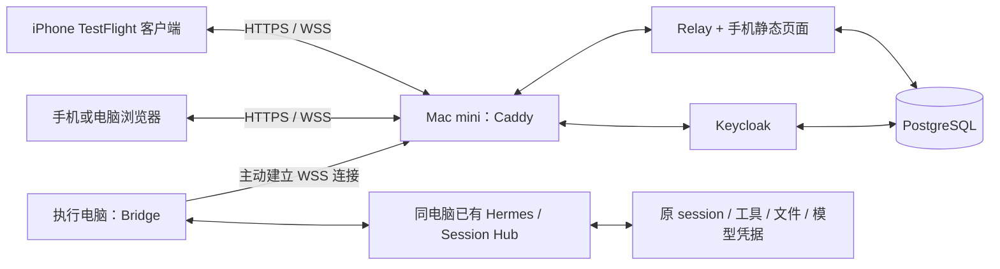

# Mac mini 服务端与 iOS TestFlight 开发交接

> 给接手开发者：本文件是交接范围、实施顺序和验收合同。请先读仓库 `AGENTS.md`、本文件及 [协议](PROTOCOL.md)，再用 `executing-plans` 或 `subagent-driven-development` 拆分并执行具体实现任务。复用现有实现；新的 iOS 登录接口先补设计与契约，再写代码。

**目标：** Mac mini 常驻部署远程控制后端，并构建可通过 TestFlight 安装到用户 iPhone 的客户端；手机查看、续接及审批电脑上的原 session，执行仍在原电脑。

**架构：** iPhone 通过 HTTPS/WSS 访问 Mac mini 的 Relay。每台执行电脑上的 Bridge 主动连接 Relay，并调用该电脑已有的 Hermes/Session Hub。Mac mini 的服务端不承担 Windows 会话的模型执行，也不启动替代会话。

**现有技术栈：** Python 3.11、FastAPI、SQLAlchemy、Authlib；PostgreSQL、Keycloak、Caddy；React/TypeScript/Vite PWA。iOS 工程、签名与 TestFlight 尚未实现。

**交接日期：** 2026-10-04。当前代码审查通过不等于 Mac 部署或 iOS 验收通过。

## 1. 责任与部署边界

| 部署位置 | 组件 | 当前状态 | Mac mini 接手工作 |
| --- | --- | --- | --- |
| Mac mini | Relay API / WebSocket：`remote_control/server.py`、`api.py`、`connections.py`、`store.py` | 已实现，Windows 本机真实链路验证 | 以 PostgreSQL 配置运行，保持一个 worker/副本；完成 HTTPS 与持久化验证 |
| Mac mini | PostgreSQL | Compose 与独立角色初始化已写 | 部署 `remote`、`keycloak` 两个库与不同受限角色；实做备份恢复、磁盘容量与迁移验证 |
| Mac mini | Keycloak 身份服务 | realm/client 模板已写；正式账号未配置 | 创建管理员、用户、精确回调地址；完成真实登录、退出、会话过期、账号恢复方案 |
| Mac mini | Caddy HTTPS/WSS 入口 | 配置已写 | 配置真实域名、证书、DNS/网络入口；验证浏览器与设备 WebSocket、请求大小限制 |
| Mac mini | 手机网页静态资源：`apps/mobile/dist` | PWA 已实现 | 构建并与 Relay 同域提供，作为浏览器入口及可复用客户端界面 |
| Mac mini | 启停、健康检查、备份和发布回滚 | 有部署说明，未在 Mac 实测 | 容器运行时自启、重启恢复、睡眠/断电恢复、日志及数据保留方案 |
| Mac mini 开发环境 | iOS 工程、Xcode archive、签名、TestFlight | **尚未实现** | 新建客户端工程，完成下面的 iOS 与分发任务 |
| Windows / 其他执行电脑 | `remote_control.bridge`、私有设备凭据与回执 journal | 已实现，Windows 实测 | 联调正式 Relay 地址和重新配对；Bridge 留在原执行电脑 |
| Windows / 其他执行电脑 | 原 Hermes 后端、Session Hub、模型登录与工具环境 | 已运行 | 升级到兼容的网关契约；保留原 home/profile/session，不复制运行环境到 Relay |

Mac mini 以后也可作为一台执行电脑，但必须单独运行自己的后端与 Bridge、明确配对自己的来源。这与它承载 Relay 是两种角色，不会自动接管 Windows 任务。



## 2. 先取得正确代码

当前 Windows 源码位于 `C:/Users/maxin/.codex/worktrees/remote-sessions/hermes-agent`，分支 `codex/remote-sessions`，基线提交为：

```text
a58f863f17013d5cd257ff57f7190ed6e35874e4
```

**本实现与交接文档一起提交在 `codex/remote-sessions` 分支；本地提交不等于已经推送。** 接收者先确认本地包含交付时提供的提交 ID，或通过 Git bundle 导入该分支；已取得该提交就不需要再应用补丁。随交接提供的 `changes.patch` 是相对上述基线的代码与文档差异，包含新增文件和原生网关修改；`MANIFEST.json` 记录基线及补丁 SHA-256。补丁包不是完整 Git 仓库，接收端必须拥有这个基线对象。

如果使用补丁接收，执行下列步骤（在已包含该基线的仓库中，补丁使用实际下载位置）：

```sh
git cat-file -e a58f863f17013d5cd257ff57f7190ed6e35874e4^{commit}
git worktree add -b codex/macmini-remote-testflight ../hermes-remote-macmini a58f863f17013d5cd257ff57f7190ed6e35874e4
cd ../hermes-remote-macmini
```

然后对 `changes.patch` 运行 `shasum -a 256` 并与 manifest 比较；用 `git apply --check` 检查后再 `git apply`。若基线对象不存在，先从用户已有仓库获取该提交；不要在不同 main 上强行应用或覆盖已有开发。接收后确认 `remote_control/`、`apps/mobile/`、`deploy/remote-control/` 和本次原生契约都存在，再按接收端工作流提交接收快照。

不要迁移 Windows `.venv`、`node_modules`、`.local-runtime`、测试账号库、原模型凭据、Bridge 设备凭据或会话数据库。Mac 使用自己的依赖环境与正式配置。正式 Relay 配对是新授权，不能复用本机测试 Relay 的设备绑定。

## 3. 全局约束

- 电脑执行权保留在原 session/profile；不通过新 CLI 会话伪造续接，不把桌面 RPC 直接暴露公网。
- 仅同步用户在配对中选择的 backend/profile/engine；图片路径受 `attachment_roots` 限制。
- Relay 目前必须保持 **一个 worker、一个副本**。PostgreSQL 不会自动解决进程内 WebSocket 路由。
- PWA 与 API 共用一个 HTTPS origin；当前没有 CORS。变更 iOS 接入不能以放开任意 Origin、关闭 CSRF 或导出长期 cookie 代替设计。
- 设备 Bearer 凭据只给 Bridge；手机使用用户登录。模型/API 凭据留在执行电脑。
- 所有执行请求保留不可变 request_id 与 payload hash；未知送达结果先查回执，`delivery_uncertain` 不自动重发。
- 只有原会话真实 pending request 才能审批/回答；执行端接受请求与任务完成分别显示。
- 网页缓存只缓存静态壳；退出/换账号清除本地账号数据，不复用上一账号的草稿、事件和审批。
- Hermes `prompt.submit` 必须支持请求自带图片和原子 busy 拒绝；完整补读要求新 `replay_generation` 契约。不能只部署 Relay 而漏掉电脑端配套更新。
- Python 测试始终用 `scripts/run_tests.sh`；平台行为在真实 Mac/iPhone 测试，不伪造操作系统。

## 4. 服务端接手任务与顺序

### S1：确定实际环境和网络入口

**阅读/修改范围：** `deploy/remote-control/compose.yaml`、`Caddyfile`、`server.example.yaml`、`realm.example.json`，以及接收端私有运行配置。

- [ ] 记录 Mac 型号/架构、macOS、可用磁盘、容器运行时版本；在该机器安装与构建，不能把此前 arm64 依赖 dry-run 当作部署通过。
- [ ] 确定两个真实 HTTPS 域名：远程产品入口和身份服务入口。配置到 `public_url`、OIDC issuer、Keycloak hostname、精确 redirect URI/web origin、Caddy，保持一致。
- [ ] 查清手机外网到 Mac 的入口：公网可达地址及转发，或用户选定的入口隧道。若网络不能接受入站，仅改 DNS 不会使 Mac 可访问；选定入口后验证长连接、证书和大小限制。
- [ ] 保持 PostgreSQL、Relay 8787、Keycloak 8080 在内部网络；现有 Compose 仅 Caddy 映射 80/443。入口隧道如替代直连，应更新拓扑与受信代理边界。

**验收：** iPhone 关闭 Wi-Fi 后，能访问可信 HTTPS 产品地址和身份服务；没有依赖 Windows 的 localhost 地址。

### S2：部署数据库、认证、中转和页面

**现成入口：** [部署说明](../../deploy/remote-control/README.md)。模板版本为 PostgreSQL `17.6-bookworm`、Keycloak `26.8.0`、Caddy `2.10.2-alpine`、Relay Python `3.11.13-slim-bookworm`；这些是代码锁定版本，部署前检查 arm64 镜像可用性与必要安全更新，升级须固定版本并复验。

- [ ] 使用项目兼容 Node/npm 从根目录安装锁定依赖，执行手机检查与构建：

```sh
npm ci
npm run typecheck --workspace apps/mobile
npm test --workspace apps/mobile
npm run build --workspace apps/mobile
```

- [ ] 在私有目录保存 `.env` 和实际域名配置，填入 `.env.example` 要求的五个独立秘密。不要把填好值的文件、Compose 展开输出或证书私钥提交。
- [ ] 部署 PostgreSQL 与 Keycloak，确认两个数据库角色独立。realm 导入只创建缺失 realm，已经存在的配置需要实际更新并复核。
- [ ] 运行一个 Relay worker，挂载刚生成的 `apps/mobile/dist`。按部署说明运行 `remote_control.migrate`；记录 schema 版本和运行镜像/源码版本。
- [ ] 创建用户正式账号，设置适合单人测试的管理员管理/恢复路径。当前模板关闭公开注册和自助重置；若要开放恢复，应另行配置并验证邮件，而不是把样例当作已完成账号产品。
- [ ] 检查 `GET /health` 返回 `ok:true`、`auth_configured:true`、`database:postgresql`、`workers:1`。该 health 响应不证明 OIDC 登录成功，仍须完成浏览器真实登录。
- [ ] 实测登录、过期、退出和撤销；退出后旧用户连接失效。Keycloak SSO 的退出行为与 Relay 本地退出区分说明。

**验收：** 正式 Keycloak 登录可以进入真实空账号；未登录不能读取会话；数据库与附件在重启后仍可读取。绝不部署 `.local-runtime` 或 `apps/mobile/tests/relay_fixture.py` 测试身份服务。

### S3：运维和故障恢复

**修改范围：** `deploy/remote-control/`，必要时补充 `remote_control/` 的真实运维缺口及相关测试。

- [ ] 容器运行时及服务自启，处理 Mac 重启、用户未登录、睡眠和网络恢复；验证而不是只写 `restart: unless-stopped`。
- [ ] 按部署说明备份两个数据库、Caddy 持久卷、私有配置；在隔离 staging 库按各自应用角色恢复并实际登录。保留原库，不能用未经验证的恢复覆盖生产。
- [ ] 记录磁盘用量、备份位置、保留周期、恢复步骤及日志轮转。当前历史、事件、回执、图片没有自动保留期限，需要选定并实现/记录运行策略。
- [ ] 单人测试也需对公网配对/登录入口验证滥用控制与并发/体积限制；先复用反向代理和现有应用边界，避免为未出现的负载引入队列集群。
- [ ] 部署回滚包含静态资源、Relay 与数据库兼容性；不把旧二进制直接指向未知新 schema。

**验收：** Mac 与容器重启后用户可重新进入；PC Bridge 重新连接，历史连续且不自动重复执行未知状态的命令；备份有恢复实证。

### S4：与原 Windows 执行电脑联调

**接口/文件：** `remote_control/bridge.py`、`bridge_sync.py`、`adapters/hermes.py`、`deploy/remote-control/bridge.example.yaml`、`tui_gateway/contracts/`。

- [ ] Windows Bridge 指向 Mac 的真实 `https://` Relay 地址，并通过正式账号重新配对；选定原有 backend/profile/engine，不默认授权所有目录。
- [ ] 为 Bridge 单独安装 remote 依赖锁，保留桌面自己的核心环境。`development:true` 仅在需要同机 loopback HTTP 后端时使用；配置仍要求非 loopback 地址 HTTPS。
- [ ] 更新电脑端原生网关并确认能力 flags 与 `replay_generation`。Mac 中转不应尝试读取 Windows 本地路径。
- [ ] 测试断网、停止 Bridge、重连、拒绝/通过审批、澄清、队列与停止、手机图片不消耗电脑暂存图片、重复请求和审批竞争。
- [ ] 将“桌面重启后端点自动恢复”列为 PC 侧联调待开发：当前 Electron 端口/token 每次启动变化，Bridge 需手动更新后重启。若首版要求无人值守，接手者需与 PC 端一起实现经过身份验证的端点发现/更新；不能仅在 Mac 上改一个 localhost 地址解决。

**验收：** 使用正式服务和账号，在一条用户明确指定的测试 session 上操作；电脑可直接看到同一条用户消息、工具审批和结果，原 session ID 不变。不要向无关个人 Codex/Claude 任务发送测试消息。

## 5. iOS 与 TestFlight 是新增交付线

仓库 `apps/mobile` 目前只有 React PWA，没有 `.xcodeproj`、iOS target、Bundle ID、签名或 App Store Connect 构建。**上传网页资源不能得到 TestFlight 安装包。** TestFlight 需要 Apple 平台 app build，并通过 App Store Connect 分发。[Apple 分发说明](https://developer.apple.com/documentation/xcode/distributing-your-app-for-beta-testing-and-releases)

### I1：建立 iOS 工程并确定复用方式

建议优先评估 **小型原生宿主 + 现有同域远程页面**，以复用已经验证的会话界面和状态逻辑。原生层处理导航、登录回调、图片选择、生命周期、网络错误与必要权限。建议新目录 `apps/ios/`，保留 `apps/mobile` 浏览器入口。

另外两种选择：完整原生 UI 可以改善深度系统集成，但需重新实现协议、历史和回执状态；本地打包 React/Capacitor 可复用界面，但本地 origin 不等于 Relay origin，必须先设计认证/CSRF/CORS 边界，不能直接宣称当前网页无修改可用。Mac 接手者在编码前记录选择和真实设备验证结果。

- [ ] 新建可在模拟器与 iPhone 启动的 iOS target，添加应用图标、启动画面、真实 Bundle ID、Team 和构建版本管理。
- [ ] 产品 endpoint 使用用户部署的固定 HTTPS origin；普通外链离开可信容器，认证回调仅接受注册的来源，不允许页面任意调用本机功能。
- [ ] 原生/网页边界只承载明确动作，不提供任意 JS 执行、终端命令或文件读取桥接。身份 cookie 不导出给网页 JS。
- [ ] 真机验证键盘、安全区、返回导航、图片选择和长历史滚动。不得通过添加 ATS 任意 HTTP 放行来处理证书问题。

仅套网页不保证满足后续外部测试/上架审核；应验证实际 iOS 交互价值和质量。Apple 对简单网页包装有明确审核说明。[App Review 4.2 相关说明](https://developer.apple.com/app-store/review/)

### I2：补齐系统登录与 WebView 会话衔接

**现状：** `remote_control/auth.py` 只实现浏览器 cookie OIDC；`/auth/callback` 设置 `remote_session` 后跳转 `/`。没有 iOS callback、原生登录 ticket 或 token exchange。`api.py` 的写操作要求精确 Origin 和 CSRF，浏览器事件连接使用登录 cookie。现有 web client secret 只能留在 Relay，不能嵌进 iOS 包。

- [ ] 先写 iOS 认证 ADR，明确 app callback/Universal Link 的所有权和绑定，优先使用系统 `ASWebAuthenticationSession`。Apple 提供此 API 执行网站认证并返回 app。[Apple 认证 API](https://developer.apple.com/documentation/authenticationservices/authenticating-a-user-through-a-web-service)
- [ ] 不假设系统认证浏览器和 `WKWebView` 自动共用登录 cookie。用真机证明登录后 `/api/remote/me`、写操作和 WSS 都属于同一用户。
- [ ] 若选择一次性登录交接：Relay 增加短期、单次使用、绑定登录尝试及 app 回调的票据，验证 state/nonce 和持有者证明；WebView 经受控同域兑换建立 HttpOnly cookie。具体接口名和载荷先写入协议，不能把未实现接口当成已有能力。
- [ ] 对新增认证路径测试重放、超时、错误 callback、换账号、取消登录及注销竞争；长期 cookie、OIDC token、设备 Bearer 不放 URL、剪贴板或日志。
- [ ] 复用后续同域网页 API、CSRF 与设备配对规则；不要为了 iOS 绕过来源授权。若决定完整原生 API client，则单独设计原生登录机制，而不是复用 Bridge 凭据。

**验收：** 冷启动登录、取消后重试、过期再登录、账号 A→B→A 均正确；不显示旧账号内容；用户退出后旧连接不能操作。

### I3：前后台与完整操作体验

- [ ] 回到前台时重新核对 `/me`、详情、pending requests 和消息，再恢复事件订阅；不能假设 iOS 后台一直保持 WebSocket。
- [ ] 使用 `hello.cursor`、gap、native epoch/runtime/replay_generation 和 Bridge generation 的既有恢复规则，不靠正文相同猜测消息去重。
- [ ] 前后台切换、锁屏、Wi-Fi↔蜂窝、短暂断网后，历史补齐、审批不过期误用、草稿不自动发送、未知送达命令不自动重发。
- [ ] 首版支持打开 app 后查看/审批即可。若另要锁屏审批提醒，新增 APNs 设备绑定、推送和通知深链是独立功能，当前尚无实现；推送不得含敏感正文，也不能在通知到达时自动审批。

### I4：签名、上传及让用户下载

- [ ] 用户的有效 Apple Developer Program / App Store Connect 团队准备好；使用实际 Team、唯一 Bundle ID、应用名称、反馈邮箱，签名私钥由 Mac 安全保管。用户处理账号登录、协议与新增凭据。
- [ ] 安装 Apple 当前接受且适配该 Mac 的 Xcode/SDK，记录 `xcodebuild -version` 与 SDK 版本。核对到 2026-10-04 的最低上传要求为 Xcode 26+、iOS 26 SDK+；上传当天重新核对，SDK 下限不等于 app 的最低运行系统。[当前上传要求](https://developer.apple.com/news/upcoming-requirements/)
- [ ] 在 App Store Connect 创建 app record，配置签名，完成 archive/validation/upload；填写 beta 说明、测试点、反馈联系信息和适用的加密合规信息。需要审核访问时提供隔离的演示账号/测试会话，不提供个人电脑任务。
- [ ] 优先让用户加入有 app 访问权的内部测试组；仅有测试者邮箱不等于内部成员。若不属于团队，则走外部测试组和 TestFlight 审核流程，不能承诺即时可下载。[内部测试者要求](https://developer.apple.com/help/app-store-connect/test-a-beta-version/add-internal-testers)
- [ ] 上传后等待处理，分配 build 给测试组；用户在 iPhone 的 TestFlight 安装并执行下面的真机验收。记录邀请方式、version/build、commit、服务端版本及失败反馈。

TestFlight build 测试期最长 90 天；外部测试的首次 build 需要审核，后续可能仍需审核。交付后需能重复上传更新。[TestFlight 流程](https://developer.apple.com/help/app-store-connect/test-a-beta-version/testflight-overview/)

## 6. 接口与代码导航

| 接手内容 | 先读文件 |
| --- | --- |
| HTTP、WebSocket、配对、回执和恢复 | `docs/remote-control/PROTOCOL.md` |
| 当前认证决策 | `docs/remote-control/AUTH-ADR.md`、`remote_control/auth.py`、`security.py` |
| Relay 生命周期、来源隔离与持久化 | `server.py`、`config.py`、`api.py`、`connections.py`、`store.py`、`db.py`（均在 `remote_control/`） |
| 电脑连接/同步/附件 | `remote_control/bridge*.py`、`adapters/hermes.py`、`adapters/hub.py` |
| 手机现有界面与请求状态 | `apps/mobile/src/app/`、`components/`、`lib/`、`store/` |
| 原生 RPC 和图片所有权 | `tui_gateway/AGENTS.md`、`tui_gateway/contracts/`、`event_replay.py`、`methods_prompt.py`、`apps/shared/src/gateway-contract.generated.ts` |
| 实际已通过验证及限制 | `docs/remote-control/IMPLEMENTATION-STATUS.zh-CN.md` |

协议主入口：`/api/remote/me`、`/devices`、`/pairings`、`/sessions`、会话 `/messages`、`/commands`、`/attachments` 与 `/api/remote/events`。Bridge 专用 `/api/remote/bridge` 不能当作 iOS API。

## 7. 最终验收与回传材料

现有 Windows 验证：手机模型/组件 30 项；最后原生/Bridge 7 文件 41 项；Hub 44 项；1000 会话/10000 消息链路有真实数据库测试。它们不替代 Mac/PostgreSQL/Keycloak/iPhone 的实测。浏览器 Playwright 源码已写，但前次实际页面验证使用 CUA，未把未运行脚本算作通过。

在隔离测试 checkout 中安装项目测试依赖后，通过 canonical runner 验证改动覆盖的用例；保持运行中的桌面核心环境与 remote 部署环境分离。不能为跑测试把独立 remote lock 覆盖进运行中的桌面 venv。

```sh
bash scripts/run_tests.sh tests/remote_control/ -j 2 --file-retries 0
bash scripts/run_tests.sh tests/tui_gateway/test_tui_gateway_event_replay.py tests/tui_gateway/test_request_owned_prompt_images.py tests/tui_gateway/contracts/test_generated.py -j 2 --file-retries 0
```

新 iOS 工程有自己的 XCTest/XCUITest 及实际 Xcode scheme；接手者在建成后补入精确构建/测试命令。不要把模拟器通过写成 iPhone 通过。

| 必须验收的行为 | 证据 |
| --- | --- |
| 用户从 TestFlight 安装并经正式账号登录 | iPhone 型号/系统、build、截图 |
| 目录/完整历史/工具结果/图片可查看 | 同一原 session 与分页前后记录；明确任何未同步记录 |
| 手机发送、排队、澄清、审批、停止真实到电脑 | 原 session ID、操作 request_id、实际结果；接受与完成区分 |
| 断网重连不重复执行，审批两端竞争只能有有效胜者 | PC journal/回执及隔离测试结果 |
| Mac 重启、PC Bridge 重启、手机前后台恢复 | 重连与完整补读记录；桌面端点轮换限制如未解决需显式列出 |
| PostgreSQL 按应用角色备份恢复 | staging 登录与会话/图片/回执查询结果 |
| 越权、退出、设备撤销生效 | 无法使用旧账号或旧设备连接继续读取/执行 |

Codex/Claude 当前复用 Hub 的目录/历史及原 App 续接能力；审批、停止、附件能力不足必须如实禁用。第一版完整控制验收以 Hermes 为准，不能用新 CLI 或虚构结果补齐第三方能力。

交付回传六项：①真实 HTTPS 地址；②部署版本/配置位置/启停方法；③备份恢复记录；④Windows Bridge 正式配对结果；⑤TestFlight 可安装 build 与邀请方式；⑥真机验收报告和仍存在的限制。只有用户实际下载安装并操作原 session 后，才标记此交接完成。

## 8. 给 Mac mini 开发会话的可复制任务

> 接手 Hermes 远程控制服务端和 iOS TestFlight 交付。先确认仓库包含交付的 codex/remote-sessions 提交；如果远程未推送，使用交接包的 Git bundle 导入或在指定基线上应用并验证 changes.patch，两种方式任选一种。阅读 `docs/remote-control/MACMINI-HANDOFF.zh-CN.md`、`PROTOCOL.md`、`IMPLEMENTATION-STATUS.zh-CN.md` 和仓库 AGENTS.md。复用 remote_control、apps/mobile 和 deploy/remote-control；先在 Mac mini 部署 PostgreSQL、Keycloak、单 worker Relay、同域页面和可信 HTTPS，完成正式登录与 Windows Bridge 配对，再开发 iOS 工程、系统登录衔接、前后台恢复、签名和 TestFlight。执行始终在原电脑的原 session，不能改成新 CLI 任务；设备 Bearer 与模型凭据不进手机。当前只有 PWA，没有可上传 iOS 工程，也没有原生登录兑换接口；先明确并记录设计再实现。域名、Apple Team/Bundle ID、签名和账号材料使用用户实际配置，不猜测，不把秘密写入仓库。完成真实 PostgreSQL 恢复及 iPhone 验收，回传 HTTPS 地址、TestFlight build/邀请、版本和限制。不要把本机测试 OIDC、模拟器或 mocked PC 当作最终验收。
